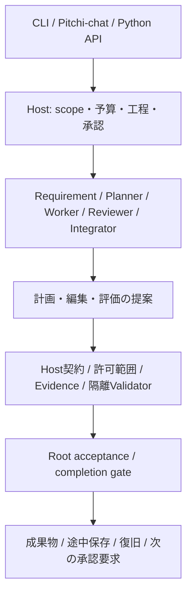

# Pitchi-work

LLMと決定的なCLIを組み合わせ、有限の仕事を安全に進めるPython HostとCLIです。
LLMの完了宣言をそのまま成功にせず、Hostが契約・証拠・検証・承認・最終判定を管理します。

> 自作部分はMIT Licenseです。外部モデル・サービスは別途導入し、それぞれの利用条件に従ってください。
> 全種類の仕事を自律完遂するシステムではありません。対応profileと利用条件を確認してください。

## Solve → Toolify → Agentify

1. **Solve**：実際の仕事を解決し、独立した条件で結果を確認する。
2. **Toolify**：再利用する価値のある決定的手順をCLI/APIへ切り出す。
3. **Agentify**：言語理解や判断が必要な部分にLLMを組み合わせる。

Hostの機能数やテスト件数を目的にせず、利用者の仕事が完了したかを評価します。
既知の手順を人間や上位AIが与えた支援付き成功と、未知案件の自律成功を区別します。

## LLMとHostの役割



| 機能 | 状態・制約 |
|---|---|
| CLIとHost-owned契約・検証・root acceptance | 実装済み。LLMへ正式条件や実行権限を委譲しない |
| 工程分割・有限修正・checkpoint・復旧 | 実装済み。既存の失敗や消費予算を勝手にリセットしない |
| ローカルLLMの全role | adapter実装済み。Strataの共通Host APIまたは明示した互換endpointを使用 |
| CLI / Python API / Chat bridge | 実装済み。対応する能力・profileだけが対象 |
| 画像OCR・索引・プレビュー | 実装済み。Pillow/Tesseract/Node/Chrome等は機能ごとに必要 |
| クラウド連携 | 任意SDK・送信ごとの承認・予算制御。初期OFF。無断送信しない |
| 旧PTOTsearch検索改善のGPU経路 | 旧BONSAI管理モジュールに依存するlegacy。公開版では明示opt-inまで拒否 |
| 万能な自律開発・任意の本番反映 | 未提供。登録validatorとscope外の仕事は成功扱いにしない |

## 導入

Linux、Python 3.11以上、uvを想定します。LLM利用前に許可workspaceと必要なツールを用意します。

```bash
git clone https://github.com/pitchipt-dotcom/pitchi-work.git
cd pitchi-work
uv sync --locked --group dev
uv run --locked pitchi-work --help
```

画像機能のPillowは通常依存です。OCRはTesseract、Web検証はNode/Chrome/bubblewrapなどを別途用意します。
ローカル利用にクラウドSDKやキーは不要です。任意SDKは`uv sync --locked --extra cloud`で追加できます。

```bash
uv run --locked pitchi-work --workspace /path/to/approved-project \
  --endpoint http://127.0.0.1:8000/api/models/strata/v1 \
  --model YOUR_CONFIGURED_MODEL --request '既存コードを調査してください'
```

これは実行を始める例です。モデル/接続/許可profile/隔離環境を設定してから使用してください。
Chat共有Strataのtokenは利用者がローカルで作成・保管し、Gitへ入れません。
APIはPython関数とCLIが中心です。独立した常駐HTTP Hostを導入する必要はありません。
詳細は[設定](docs/CONFIGURATION.md)と[安全性](SECURITY.md)を参照。

## 検証と承認

source pin、Host validator、root acceptance、明示承認、隔離、有限予算は公開版でも保持します。
本番反映の権限と、単にCLIを実行できることは別です。ソースを変えた後は変更内容をレビューしてpinを更新します。

```bash
uv run --locked --group dev python -m pytest -q
```

private saved-runを使う回帰はfixtureを配布せず、明示指定時だけ実行する別レーンです。
通常テストのskipを実モデル合格に読み替えません。[検証記録](docs/VALIDATION.md)を参照。

## 関連資料

[Pitchi-chat](https://github.com/pitchipt-dotcom/pitchi-chat) · [MIT License](LICENSE) ·
[Privacy](PRIVACY.md) · [Contributing](CONTRIBUTING.md) · [第三者依存](THIRD_PARTY_NOTICES.md)

## ライセンス

自作のプログラム・テスト・文書は[MIT License](LICENSE)。Copyright (c) 2026 pitchipt-dotcom。
[適用範囲](LICENSE_SCOPE.md)と[コードの由来](docs/PROVENANCE.md)を確認してください。
第三者の依存ライブラリ・モデル・ソフトの条件は別です。[適用範囲](LICENSING.md)を確認してください。
